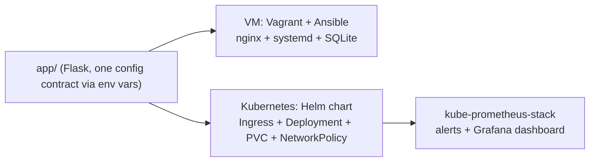
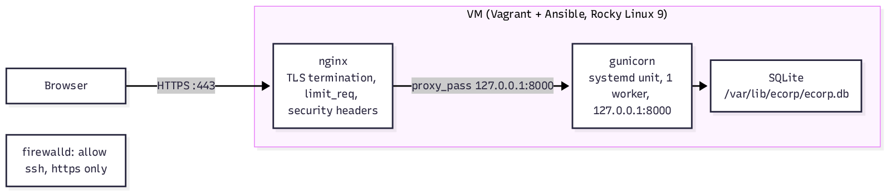
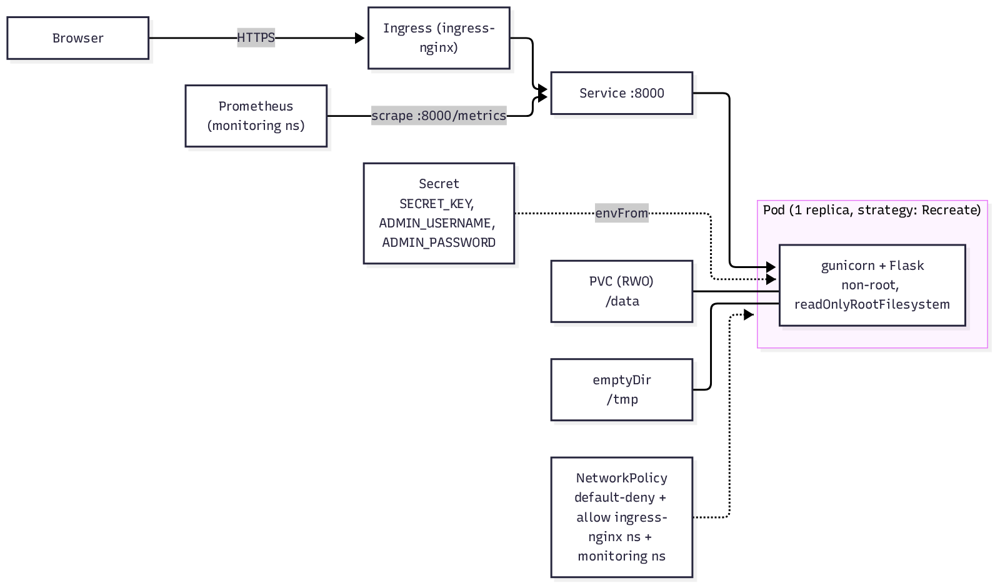

# E-Corp SRE Challenge

A Flask login app, fixed and deployed two ways: a hardened VM (Vagrant +
Ansible + nginx + systemd) and Kubernetes (Helm + Prometheus/Grafana). One
app, one config contract, two targets - see `docs/architecture.md`.


## Quick start

```bash
make test       # run the app's test suite (22 tests)
make kind-up    # local Kubernetes cluster, Calico, ingress-nginx
make deploy     # build the image, load it into kind, helm install
```

Then `kubectl get secret ecorp -o jsonpath='{.data.ADMIN_PASSWORD}' | base64 -d`
for the generated admin password, and see the chart's `NOTES.txt` output for
the URL.

For the VM: `cd vm && vagrant up`, then `https://localhost:8443`
(self-signed certificate - your browser will warn, that's expected).

## Architecture



Full diagrams (VM and Kubernetes, each with every component) and the
reasoning behind every non-obvious choice: `docs/architecture.md`.


## VM architecture



## Kubernetes architecture



## Design decisions

- **SQLite, on purpose.** It forces `replicas: 1`, a `ReadWriteOnce` PVC,
  and `strategy: Recreate` - all hardcoded in the chart, not values, so the
  constraint can't be silently violated. The Postgres path to
  `replicas > 1` is in `docs/architecture.md`.
- **gunicorn runs 1 worker**, not a `cpu_count()` formula: it matches the
  actual CPU budget on both targets (1 vCPU VM, 250m-limit pod), and it's
  what makes Flask-Limiter's in-memory rate limit a real global counter
  instead of one counter per worker. See `docs/architecture.md` for the
  full reasoning - this surprised me when I actually load-tested it rather
  than just reading the code.
- **Helm, not raw manifests**, for per-environment configurability
  (`values.yaml`) while keeping the chart itself small (11 templates).
- **No GitOps, no service mesh, no External Secrets Operator.** All three
  are the right next step for a real production rollout, not for a single-replica demo app. 
  Adding them here would cost readability for no benefit at this scale.
- **In-memory rate limiter**, not Redis. Same reasoning as the SQLite.

## How the objectives are addressed

- **Functionality:** the app works, logs in, shows the two secret cards,
  logs out - verified live against a real running container under the
  actual production security constraints (`--read-only`, non-root), not
  just unit tests. See the "Live verification" section in
  `docs/findings.md`.
- **Simplicity:** one Flask app, one Docker image, no service mesh, no
  GitOps controller, no second database. Every added moving part (CSRF,
  rate limiting, structured logging) is there because a specific finding
  needed it, not speculatively.
- **Readability:** the app is a small package (`config.py`, `db.py`,
  `auth.py`, `metrics.py`, under 50 lines each) instead of one file; the
  Helm chart is 11 templates with one job each; the Ansible role splits
  into `packages.yml`, `app.yml`, `secrets.yml`, `service.yml`, `nginx.yml`,
  `firewall.yml`.
- **Extensibility:** config is entirely env-driven, so a new environment is
  a new `values-*.yaml`, not a code change. `existingSecret` lets a real
  deployment swap in Vault/External Secrets without touching the chart.
- **Maintainability:** 22 tests at 99 percent coverage
  (`app/tests`, run with `make test`), pinned and locked dependencies
  (`pip-compile`), CI gates every change (`.github/workflows/ci.yml`:
  ruff, pytest, bandit, pip-audit, hadolint, trivy, helm lint, kubeconform).
- **Observability:** see below.
- **Security:** this is most of what F1-F14 are. Beyond the findings:
  non-root, read-only root filesystem, dropped capabilities, and a
  default-deny NetworkPolicy in Kubernetes; `ufw` default-deny plus a
  hardened systemd unit (`NoNewPrivileges`, `ProtectSystem=strict`,
  `PrivateTmp`, and more) on the VM. A formal STRIDE-per-element threat model of the whole system -
  every element, every trust boundary, every threat with a disposition -
  is in `docs/threat-model-ecorp-20261018-150407.md`.

## Observability

- **Metrics** (`/metrics`, `prometheus-flask-exporter` plus a custom
  `ecorp_login_attempts_total{outcome}` counter): request rate, latency
  histogram, status codes, login outcomes.
- **Logs:** structured JSON to stdout, never containing a password (see
  F3). On the VM, journald captures them (`journalctl -u ecorp`).
- **Alerts** (`charts/ecorp/templates/prometheusrule.yaml`, toggled by
  `metrics.prometheusRule.enabled`): `EcorpDown` (no scrape for 2m),
  `EcorpHighErrorRate` (5xx ratio over 5 percent for 5m),
  `EcorpLoginFailureSpike` (more than 10 failed logins in 5 minutes - a
  brute-force signal, confirmed above 5/min now means something now that
  the limiter actually works globally).
- **Dashboard** (`charts/ecorp/dashboards/ecorp.json`, toggled by
  `metrics.dashboard.enabled`, picked up by kube-prometheus-stack's Grafana
  sidecar): request rate, 5xx error rate, p95 latency, login
  success/failure, pod restarts. the chart was
  validated with `helm template` + `kubeconform` against the real chart
  schema, not deployed to a shared cluster to grab one (see below).

## Production roadmap

Postgres instead of SQLite (to allow `replicas > 1`), a shared rate-limit
backend once there's more than one worker, External Secrets or Vault
instead of a chart-managed Secret, cert-manager for Ingress TLS, GitOps
(Flux or Argo CD), image signing (cosign) and an SBOM in CI, and
path-level `/metrics` isolation in Kubernetes to match what nginx already
does on the VM. Full reasoning for each: `docs/architecture.md`.