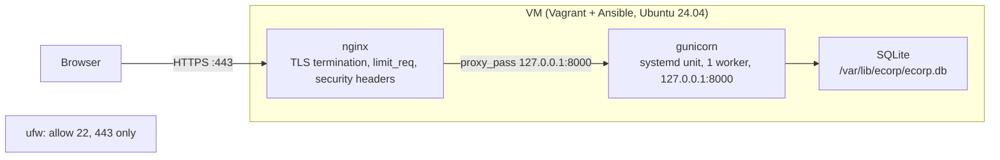
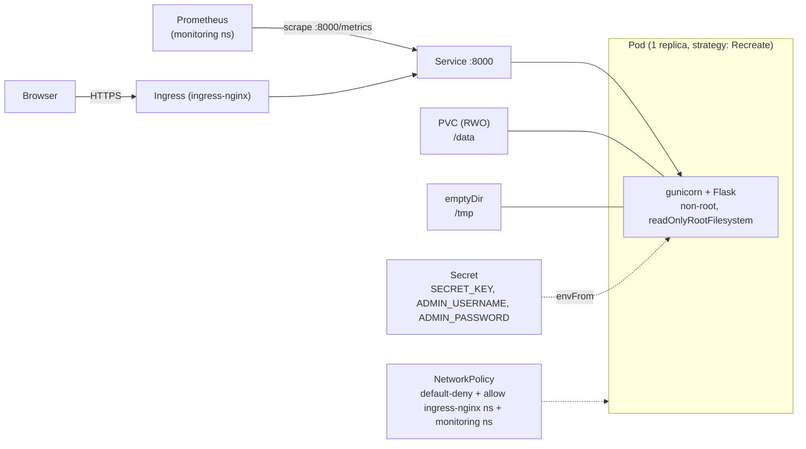

# Architecture

One Flask app, one config contract (environment variables), two deployment
targets. Nothing in `app/` knows whether it is running on a VM or in a pod.

## VM

Provisioning: `vagrant up` runs the `ecorp` Ansible role (`vm/ansible/roles/ecorp`).
It installs nginx and the app's virtualenv, generates `SECRET_KEY` and
`ADMIN_PASSWORD` once (reused on every later provision, see
`vm/ansible/roles/ecorp/tasks/secrets.yml`), runs `flask init-db`, installs a
hardened systemd unit, and configures nginx with a self-signed cert. A second
`vagrant provision` reports no changes.

## Kubernetes

Chart: `charts/ecorp`. `helm install` generates `SECRET_KEY`/`ADMIN_PASSWORD`
once via `lookup` against the live Secret (same "generate once, reuse on
upgrade" rule as the VM's Ansible role; see `templates/secret.yaml`), unless
`secrets.existingSecret` points at one you created yourself.

## Same artefact, two targets

The app only ever reads `SECRET_KEY`, `DATABASE_PATH`, `ADMIN_USERNAME`,
`ADMIN_PASSWORD`, `SESSION_COOKIE_SECURE`, `LOG_LEVEL`, `GUNICORN_BIND`,
`GUNICORN_WORKERS`. The VM's `ecorp.env` and the chart's Secret/env block are
two renderings of that one contract; `app/Dockerfile` is the one build both
targets run (gunicorn on the VM is installed into a virtualenv from the same
`requirements.txt`, not from the image).

## Why SQLite forces 1 replica

SQLite's writer lock is per-file, not per-cluster. Two pods writing the same
file would corrupt it; two pods each with their own file would each show a
different set of users. Kubernetes can't share a PVC with `ReadWriteOnce`
across nodes either, so the Deployment is pinned to `replicas: 1` directly in
the template (not a value - see `charts/ecorp/templates/deployment.yaml`),
with `strategy: Recreate` so the old pod's SQLite file is fully released
before the new one starts.

**Production path to replicas > 1:** move to Postgres (managed, or the
Zalando/CloudNativePG operator), drop the PVC and `Recreate` strategy, add an
HPA and a PodDisruptionBudget, and move Flask-Limiter's in-memory store to a
shared backend (see below). None of that is implemented here - SQLite is a
deliberate simplicity trade-off for a challenge, not a sizing decision.

## Why gunicorn runs 1 worker, not `cpu_count() * 2 + 1`

Two independent reasons converge on the same number:

1. **Resources.** The VM is 1 vCPU; the pod requests 50m/limits 250m CPU
   (`charts/ecorp/values.yaml`). Extra sync workers would queue behind that
   CPU limit, not add real concurrency.
2. **Correctness.** Flask-Limiter's `memory://` storage is per-process.
   With N worker processes, the "5 per minute" login limit becomes N
   independent counters, so a client round-robined across workers gets
   roughly `5*N` attempts, not 5. One worker makes it an actual global
   counter (see `app/gunicorn.conf.py` and `app/ecorp/__init__.py`).

A multi-replica, multi-worker future needs a shared rate-limit backend
(Redis) regardless - this is the same trade-off as the SQLite one, just at a
different layer.

## NetworkPolicy is L3/L4, not L7

`charts/ecorp/templates/networkpolicy.yaml` default-denies ingress to the pod
except from the `ingress-nginx` and `monitoring` namespaces, on port 8000.
That is real, enforced isolation for *which namespaces* can reach the pod at
all. It cannot distinguish `GET /` from `GET /metrics` within that allowed
traffic, because NetworkPolicy operates below HTTP. The VM gets real
path-level protection for `/metrics` (nginx `deny all` on that location,
`vm/ansible/roles/ecorp/templates/ecorp.conf.j2`) because nginx is an L7
proxy. The Kubernetes equivalent - a second internal-only Service/Ingress
for `/metrics`, or an ingress-controller path rule - is listed in the
roadmap below rather than implemented, to keep the chart's Ingress at one
simple rule.

## Production roadmap

Roughly in the order it would actually get done:

- **Postgres instead of SQLite**, to allow `replicas > 1`, an HPA and a PDB.
- **Shared rate-limit backend** (Redis) once there is more than one gunicorn
  worker or one pod.
- **External Secrets Operator or Vault** instead of a plain Kubernetes
  Secret templated from `values.yaml` / generated by `lookup`.
- **cert-manager** for the Ingress TLS certificate instead of `tls.enabled`
  pointing at a manually-created secret.
- **GitOps (Flux or Argo CD)** instead of `helm upgrade --install` from a
  laptop or a CI job's `helm` step.
- **Image signing (cosign) and an SBOM** (`syft`/`trivy sbom`) attached to
  the GHCR push in `.github/workflows/ci.yml`.
- **Path-level `/metrics` isolation** in Kubernetes (see above).
- **A second environment** (staging) via a `values-staging.yaml`, since the
  chart already externalizes everything environment-specific.

None of these were left out by oversight - each one adds a moving part this
challenge's "simplicity" objective doesn't ask for at this scale.
