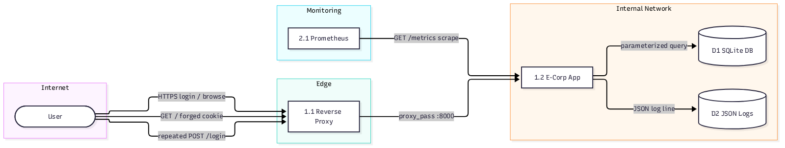

# Threat Model - E-Corp

| | |
|---|---|
| **System / scope** | E-Corp login application, as deployed on both targets built for the Warpnet SRE Challenge: a Vagrant/Ansible VM (nginx + gunicorn + SQLite on Rocky Linux 9) and Kubernetes (ingress-nginx + gunicorn pod + PVC-backed SQLite). The Flask app and its config contract are identical on both; the reverse proxy and data-store implementation differ only in packaging. Out of scope: the CI/CD pipeline itself, GHCR, and the underlying host/cluster OS hardening beyond what this project configures. |
| **Author** | Adam Bouafia |
| **Date** | 2026-10-18 15:04:07 |
| **Method** | Four Question Framework + STRIDE-per-element (Shostack 2014 / MS Threat Modeling Tool) |
| **Status** | Draft |

---

## 1. What are we building?

### 1.1 System overview

E-Corp is a small Flask application with a single admin account. A user logs
in with a username/password, and once authenticated sees two "secret" cards
on the home page. The app is fronted by a reverse proxy that terminates TLS
and adds a second layer of rate limiting, stores its one user row in SQLite,
emits structured JSON logs, and exposes Prometheus metrics. It is deployed
twice - once directly on a VM's OS, once as a container on Kubernetes - using
the exact same application code and the same environment-variable config
contract (`SECRET_KEY`, `DATABASE_PATH`, `ADMIN_USERNAME`, `ADMIN_PASSWORD`,
`SESSION_COOKIE_SECURE`, `LOG_LEVEL`).

### 1.2 Assumptions & scope decisions

- The VM's nginx and Kubernetes' ingress-nginx play the same logical role
  (**Reverse Proxy**), as do the VM's `/var/lib/ecorp/ecorp.db` file and the
  K8s PVC-backed SQLite file (**SQLite DB**). One diagram models both
  deployments at the logical level the challenge's own brief calls out
  ("same artefact, two targets") rather than drawing two near-identical DFDs.
- There is only one real-world actor: whoever controls the browser hitting
  the app. The system has no way to distinguish a legitimate admin from an
  attacker at the network level - both are modelled as the single `User`
  external entity, with distinct flows for the distinct *patterns* of use
  (normal login vs. forged-cookie vs. brute-force), rather than inventing a
  separate "Attacker" node that STRIDE has no clean way to apply to itself.
- Prometheus is modelled as an internal process in its own trust zone, not
  an external entity - it's part of the deployed stack, not an actor outside
  this project's control, but it does sit in a different trust boundary from
  the app itself (a separate K8s namespace / a separate concern on the VM).
- Out of scope: compromise of the underlying hypervisor/cluster control
  plane, supply-chain attacks on the base container image or Rocky/Ubuntu
  package mirrors, and physical access to either host. These are real risks
  but outside what this project's code and config can address.
- In scope: everything the Flask app, the reverse-proxy config, and the data
  stores do, and the trust boundaries between them.

### 1.3 Elements

| Type | ID | Name | Description |
|------|----|------|--------------|
| External | User | User | Any browser reaching the app over the internet - the single admin account holder, or an attacker; indistinguishable at the network layer. |
| Process | 1.1 | Reverse Proxy | nginx (VM) / ingress-nginx + Service (K8s). TLS termination, security headers, `limit_req` on `/login`. |
| Process | 1.2 | E-Corp App | gunicorn (1 worker) running the Flask app factory: auth, session, metrics, health. |
| Process | 2.1 | Prometheus | Scrapes `/metrics` on a schedule. Part of the deployed stack, separate trust zone. |
| Data store | D1 | SQLite DB | The single `users` table - one admin row, scrypt-hashed password. |
| Data store | D2 | JSON Logs | Structured stdout logs (journald on the VM, container log stream on K8s): login attempts, readiness failures. |

### 1.4 Trust boundaries

- **Internet** - contains: `User`; trust level: none, fully untrusted.
- **Edge** - contains: `1.1` (Reverse Proxy); trust level: internet-facing, the
  only thing actually reachable from outside on either target.
- **Internal Network** - contains: `1.2` (E-Corp App), `D1`, `D2`; trust
  level: never directly reachable from the internet - gunicorn binds
  `127.0.0.1` only on the VM, and the K8s NetworkPolicy default-denies
  everything except the ingress-nginx and monitoring namespaces.
- **Monitoring** - contains: `2.1` (Prometheus); trust level: internal, but a
  distinct zone from the app runtime - this is exactly the boundary the
  K8s NetworkPolicy and the VM's nginx `allow 127.0.0.1` rule both exist to
  enforce for `/metrics` specifically (finding F10).

### 1.5 Data Flow Diagram

```text
threatmodel "E-Corp (VM and Kubernetes targets)"
external: User
process 1.1: Reverse Proxy
process 1.2: E-Corp App
process 2.1: Prometheus
datastore D1: SQLite DB
datastore D2: JSON Logs
User -> 1.1 : "HTTPS login / browse"
User -> 1.1 : "GET / with forged session cookie"
User -> 1.1 : "Repeated POST /login attempts"
1.1 -> 1.2 : "proxy_pass to 127.0.0.1:8000"
1.2 -> D1 : "Parameterized query (credentials)"
1.2 -> D2 : "JSON log line (login outcome)"
2.1 -> 1.2 : "GET /metrics (scrape)"
boundary "Internet" { User }
boundary "Edge" { 1.1 }
boundary "Internal Network" { 1.2, D1, D2 }
boundary "Monitoring" { 2.1 }
```

> Diagram in `threatmodel` syntax - paste into
> `~/.claude/skills/threat-modelling/renderer/index.html` to render, validate
> and export a PNG. Flows that cross a trust boundary (every `User -> 1.1`
> flow, and `1.1 -> 1.2`) are the highest-priority attack surface.



*(Rendered with Mermaid rather than Threat·Studio for this copy - same DFD,
same trust boundaries and flows as the `threatmodel` source above.)*

---

## 2. What could go wrong? (STRIDE-per-element)

| ID | Element | STRIDE | Threat (precondition → action → impact) | Risk |
|------|---------|--------|-------------------------------------------|------|
| T-01 | User → 1.1 (flow, boundary-crossing) | S | If `SECRET_KEY` were hardcoded or leaked (the app's original state), an attacker crafts their own signed `{"username":"admin"}` cookie and sends it straight to `1.1`, skipping the login flow entirely and landing on the authenticated home page. | High |
| T-02 | User → 1.1 (flow, boundary-crossing) | S | An attacker who has the historical plaintext/weak-hashed admin password (the app's original committed DB) authenticates as the real admin with no forgery needed. | High |
| T-03 | User → 1.1 (flow, boundary-crossing) | D | An attacker sends many `POST /login` attempts to brute-force the admin password; the original app had zero rate limiting anywhere. | High |
| T-04 | User → 1.1 (flow) | S | Login CSRF: a third-party page silently submits a login form on the victim's behalf (fixating a session the victim didn't choose), or the original GET-based `/logout` link logs a victim out just by loading as an ``. | Medium |
| T-05 | 1.1 (process) | S | Self-signed TLS cert means no public CA validates the proxy's identity - a user who ignores the browser warning, or an attacker performing a MITM with their own self-signed cert, can't be distinguished by the browser the way a CA-signed cert would allow. | Medium |
| T-06 | 1.1 (process) | D | `limit_req` only covers `/login`. A volumetric flood against `/` or `/metrics`-adjacent paths has no proxy-level throttle at all. | Medium |
| T-07 | 1.1 (process) | E | An unpatched nginx CVE compromises the edge process; from there the attacker is still only on the Edge, not automatically inside the Internal Network (gunicorn only listens on loopback / the pod's NetworkPolicy still applies). | Low |
| T-08 | 1.1 → 1.2 (flow, boundary-crossing) | T | Plaintext HTTP between proxy and app (loopback on the VM, pod-local on K8s) - if that boundary were ever crossed by something other than loopback/pod network, traffic including the session cookie would be visible in transit. | Low |
| T-09 | 1.2 (process) | T | `SELECT * FROM users` + Python `==` compare (the original code) is one step from a classic SQL-structure bug if the query were ever built with string interpolation instead of `?` placeholders. | Medium |
| T-10 | 1.2 (process) | I | Logging the raw password on every login attempt, success or failure (the original code) - failed attempts in particular often contain a near-correct password, which is especially damaging if logs are ever centralised. | High |
| T-11 | 1.2 (process) | I | A log-injection attack: a username containing a newline forges extra, fake log lines once written unsanitised. | Medium |
| T-12 | 1.2 (process) | D | Flask-Limiter's in-memory counter is per-process; with more than one gunicorn worker, "5 per minute" silently becomes N independent counters - the rate limit would stop meaning what it claims. | Medium |
| T-13 | 1.2 (process) | E | `DATABASE_PATH` resolved as a relative path (the original code) means starting the process from the wrong working directory silently creates and uses an *empty* database rather than failing loudly - not a privilege escalation in the classic sense, but the process ends up operating on unintended data. | Low |
| T-14 | D1 (data store) | I | The original committed `database.db` stores the admin password in plaintext - anyone with repo access (or a leaked backup) has the live credential outright. | High |
| T-15 | D1 (data store) | I | Even hashed (scrypt), an exfiltrated DB file is crackable offline given enough compute - a single, long, random admin password reduces this but doesn't eliminate it. | Low |
| T-16 | D1 (data store) | D | SQLite is single-writer; this is why the whole deployment is locked to one replica and a `Recreate` rollout strategy rather than a design that could tolerate concurrent writers. | Low |
| T-17 | D2 (log store) | R | No signing or append-only remote shipping of the login-attempt log - an attacker with host/container access could edit or delete log lines after the fact, erasing evidence of their own brute-force attempt. | Medium |
| T-18 | D2 (log store) | I | Usernames and source IPs in the logs are still mildly sensitive (PII-adjacent); no access control beyond "whoever can read journald / the container's log stream." | Low |
| T-19 | 2.1 → 1.2 (flow, boundary-crossing) | I | If `/metrics` were reachable from outside the Monitoring zone, an attacker could read `ecorp_login_attempts_total{outcome="failure"}` directly - live telemetry on exactly how close their brute-force attempt is to detection, letting them tune their attack to stay under the alerting threshold. | Medium |
| T-20 | User (external entity) | R | No non-repudiation beyond the login-outcome log itself - acceptable here since there's a single admin account and no further write actions exposed to the authenticated user to repudiate. | Low |

---

## 3. What are we going to do about it?

| Threat ID | Disposition | Control / action | Standard | Owner |
|-----------|-------------|-------------------|----------|-------|
| T-01 | Mitigate | `SECRET_KEY` required from env, app refuses to start without it; never committed | OWASP ASVS 3.x (session mgmt) | Adam |
| T-02 | Mitigate | `werkzeug.security` scrypt hashing; DB never committed; seeded at deploy time via `flask init-db` | OWASP ASVS 2.4 | Adam |
| T-03 | Mitigate | Flask-Limiter `5/min` per IP on `POST /login`, plus a second independent `limit_req` at the nginx layer | STRIDE: DoS → availability controls | Adam |
| T-04 | Mitigate | Flask-WTF CSRF token on the login form; logout moved to a POST form | OWASP ASVS 4.2 (CSRF) | Adam |
| T-05 | Accept | Self-signed cert is an explicit, documented simplicity trade-off for this challenge; production path is a real CA (e.g. cert-manager + Let's Encrypt) | - | Adam |
| T-06 | Accept | Out of scope for this challenge's grading criteria; noted as a production-roadmap item (WAF / broader rate limiting) | - | Adam |
| T-07 | Mitigate | Defense in depth: gunicorn never directly internet-reachable even if the proxy is compromised (loopback bind / NetworkPolicy) | STRIDE: EoP → least privilege | Adam |
| T-08 | Accept | Loopback (VM) and pod-local (K8s) traffic only; terminating TLS a second time hop-internal would add complexity disproportionate to the residual risk | - | Adam |
| T-09 | Mitigate | Parameterised `SELECT ... WHERE username = ?`; `check_password_hash`, not `==` | OWASP ASVS 5.3 (injection) | Adam |
| T-10 | Mitigate | Never log the password; log only the sanitised username and the outcome, structured JSON | STRIDE: Info disclosure → data minimisation | Adam |
| T-11 | Mitigate | Strip control characters and cap length on the username before it reaches a log line | OWASP ASVS 7.x (logging) | Adam |
| T-12 | Mitigate | `GUNICORN_WORKERS=1` by default, documented rationale in `gunicorn.conf.py`; production path is a shared store (Redis) if more workers/replicas are ever needed | - | Adam |
| T-13 | Mitigate | `DATABASE_PATH` from env, defaulting to Flask's own `instance/` path, not cwd-relative | OWASP ASVS 14.x (config) | Adam |
| T-14 | Mitigate | Same control as T-02 - no plaintext password, no committed DB file, `*.db` and `instance/` gitignored | OWASP ASVS 2.4 | Adam |
| T-15 | Accept | scrypt is deliberately slow; residual offline-cracking risk accepted given a single, long, random credential and the challenge's scope | - | Adam |
| T-16 | Accept | Documented trade-off (README production roadmap: Postgres → stateless app → replicas > 1 + HPA/PDB) | - | Adam |
| T-17 | Accept | Out of scope for this challenge; production path is centralized, access-controlled, append-only log shipping | - | Adam |
| T-18 | Accept | Standard operational log access control (host/cluster RBAC) covers this; no additional control added within the app itself | - | Adam |
| T-19 | Mitigate | `/metrics` allowed from `127.0.0.1` only (VM, nginx) / from the monitoring namespace only (K8s NetworkPolicy) - never exposed publicly | STRIDE: Info disclosure → least-privilege access | Adam |
| T-20 | Accept | Single-admin-account app with no further mutating actions exposed; logging already covers the one action that matters (login outcome) | - | Adam |

---

## 4. Did we do a good job?

### 4.1 Coverage

- [x] Every element appears in section 2 with its applicable STRIDE categories considered.
- [x] Every boundary-crossing flow (`User -> 1.1` ×3, `1.1 -> 1.2`, `2.1 -> 1.2`) has explicit threats.
- [x] Every threat in section 2 has a disposition in section 3.
- [x] Diagram validated against the Threat·Studio Common Mistakes checklist (every flow labelled, no store→store or external→external flows, no ghost IDs, every element in at most one boundary, no duplicate IDs).


### 4.3 Limitations & next review

- This model treats the VM and Kubernetes deployments as one logical system
  per §1.2. A deeper pass could threat-model the CI/CD pipeline itself
  (GHCR push, Trivy gate, image provenance) as its own system - not done
  here, flagged as a limitation rather than silently skipped.
- Host/cluster-level compromise (hypervisor, kubeadm control plane, base
  image supply chain) is explicitly out of scope; this model only covers
  what the application and its deployment config can control.
- **Revisit when:** SQLite is replaced with Postgres (changes D1's threat
  profile and the replica-count trade-offs throughout), or if the app ever
  gains a second user role or a write action beyond login/logout.
